# BC250 themes

Eight themes for [turing-smart-screen-python](https://github.com/mathoudebine/turing-smart-screen-python), made for a **3.5" Turing screen** (landscape or portrait) on an **AMD BC-250 Steam Machine running Bazzite**. Seven of them show the same live data; the radar trades some of it for live flights; pick one with `--theme`.

**Phosphor** (default): a retro green-phosphor terminal, with a CRT warm-up and a 3D logo at boot.

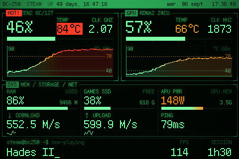 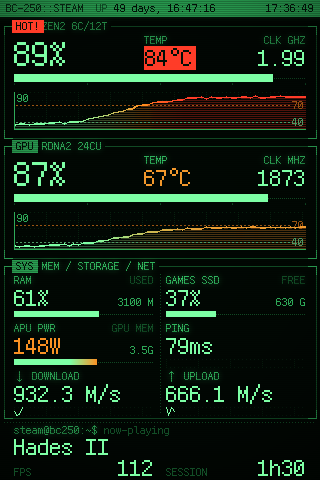

**Game Boy** (`--theme gameboy`): the 4-shade DMG screen as a handheld-RPG status screen. CPU and GPU are party cards with HP bars, there's an ITEMS box, and a dialog box at the bottom ("RAFALE IS PLAYING"). At boot your logo drops in, then a SYSTEM CHECK menu runs.

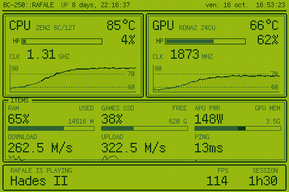 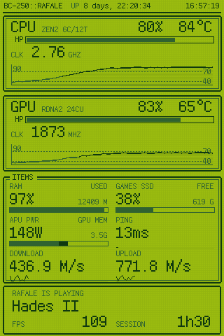

**Retrowave** (`--theme retrowave`): neon pink and cyan on a purple night, with arcade wording at the bottom ("1UP RAFALE NOW PLAYING", "INSERT COIN" when idle). At boot a neon grid rushes towards you under a striped sunset, a laser scans in your logo in chrome, then a SYSTEM CHECK panel opens on the grid.

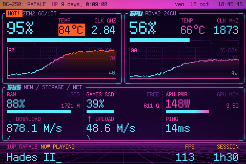 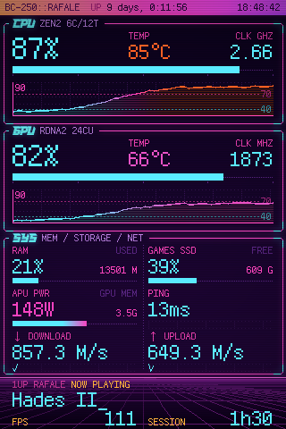

**Videotex** (`--theme videotex`): a French 40-column videotex page in 8 flat colours, in French. CPU and GPU are coloured pages with mosaic bar charts of their temperature, under a teletext header (`P250 BC-250 … ven. 16 oct. 21:30:12`), and the bottom line is a ticker ("EN COURS : Hades II"). At boot it dials `3615 BC250`, shows the modem handshake, then draws the service page row by row.

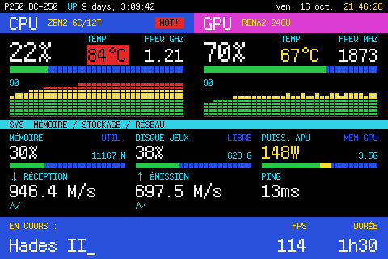 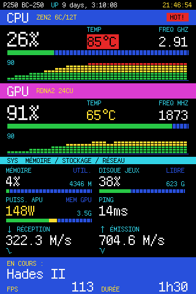

**Mission Control** (`--theme mission`): a 1969 flight-controller console, white and amber telemetry in CRT windows set in grey. CPU and GPU are STAGE 1 and STAGE 2, temperatures read THERMAL, APU power PWR BUS, and the header shows the mission elapsed time (your uptime, `MET 003:14:22:05`) and the day of the year. The bottom line reads "FLIGHT: Hades II", or "HOLDING" when idle. At boot the flight director runs a GO/NO-GO poll of every station, then the countdown clock goes T-10, IGNITION, LIFTOFF with a flash.

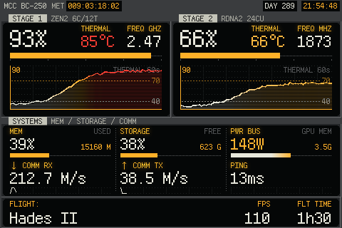 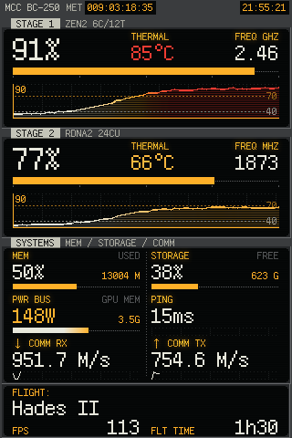

**Minecraft** (`--theme minecraft`): light grey inventory panels on dark dirt. CPU and GPU sit on creative-menu tabs, load bars are XP bars, the temperature history is a column of little blocks, and the bottom line is a chat box ("PLAYING Hades II", "rafale is AFK"). At boot your logo is built from stone blocks with a pulsing yellow splash line, then the world loads.

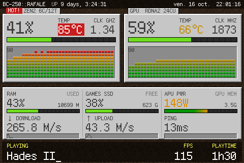 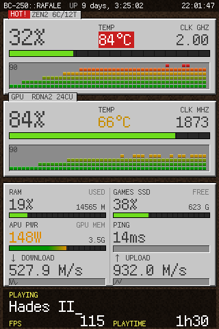

**Nixie** (`--theme nixie`): a Nixie-tube instrument panel, neon-orange digits behind their anode mesh on a black front with brass engraving. A six-tube clock on top; CPU and GPU load, temperature and clock on tubes with glowing bar tubes and a red warning lamp; RAM, SSD and APU power on tubes too. At boot the tubes strike one by one, spin like a slot machine and settle on the time, then a row of neon lamps lights up for the self-test.

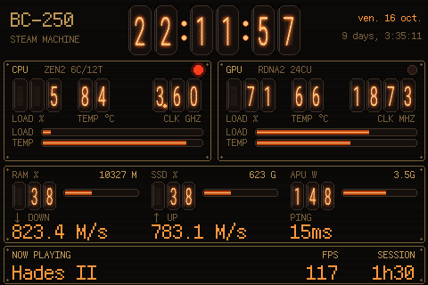 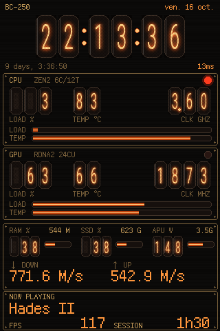

**Radar** (`--theme radar`): live aircraft around a point you choose, from free community ADS-B data. A military-green radar scope with range rings, the airports and runways in range, and a sweeping beam; each aircraft is a target that flashes as the beam passes and fades behind it, shaded by altitude (yellow-green low, green mid, teal high, red for an emergency squawk) with an ATC-style tag (callsign, flight level, speed). Beside it: the nearest flight in big letters (callsign, route, airline, altitude, speed, type, distance), the next four, CPU and GPU temperature and load, and what's playing.

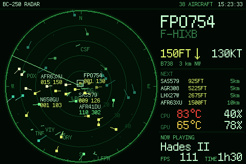 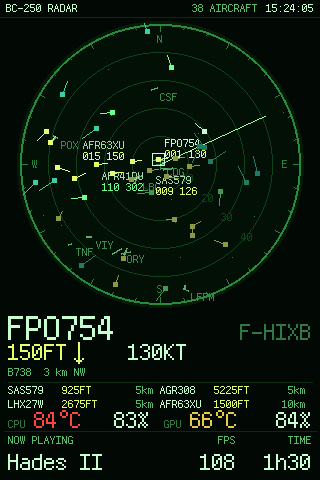

```bash
bash bc250-themes/setup.sh --theme radar --radar-lat 48.8584 --radar-lon 2.2945 --radar-range 50
```

- Coordinates in decimal degrees (Google Maps: right-click a spot); `48°51'30"N` style works too, quoted. Range 5 to 400 km.
- Your coordinates stay on the BC-250 (in the saved setup options), and are sent only to the data services below.
- Data: aircraft from [adsb.lol](https://adsb.lol) (falls back to [adsb.fi](https://adsb.fi)), routes from [adsbdb](https://www.adsbdb.com), airports from [OurAirports](https://ourairports.com) (downloaded once at setup). Free community services for personal use: the radar asks every 6 s and stops while the screen sleeps. Routes are only shown when they fit where the aircraft actually is (community route data can be stale).
- `bc250_check.py` tells you whether the data services answer.
- Tip: a plane-spotting screen should stay bright: add `--dim-after 0`.

*Game Boy- and Minecraft-inspired fan themes, not affiliated with or endorsed by Nintendo, Mojang or Microsoft; they use no logos or game assets (all art is drawn by `make_theme.py`). Retrowave's logo uses the Race Space font that comes with the app (free for non-commercial use).*

## Quick start

1. **Get the theme** in the folder that holds your `turing-smart-screen-python` folder (or in your home, if the app is at `~/turing-smart-screen-python…`):
   ```bash
   git clone https://github.com/raphaeltournafond/bc250-themes
   ```
   Don't have the app yet? Get it into your home folder first:
   ```bash
   git clone --depth 1 --branch 3.10.0 https://github.com/mathoudebine/turing-smart-screen-python ~/turing-smart-screen-python
   ```
2. **Run the setup** (plug the screen in first):
   ```bash
   bash bc250-themes/setup.sh
   ```
3. **For FPS in games**, paste this into each game's *Properties > Launch Options* in Steam:
   ```
   MANGOHUD_CONFIG=fps_only,alpha=0,autostart_log=1,log_interval=1000,output_folder=~/mangologs mangohud %command%
   ```

That's it: the screen now starts with the boot animation every time the BC-250 boots.

| To… | Run |
|---|---|
| update the theme | `git -C bc250-themes pull && bash bc250-themes/setup.sh` |
| switch theme | `bash bc250-themes/setup.sh --theme gameboy` (or `retrowave`, `videotex`, `mission`, `minecraft`, `nixie`, `radar`, `phosphor`) |
| change an option | `bash bc250-themes/setup.sh --night 23:30-08:00 --logo "MY RIG"` (remembered for next time) |
| go back to the defaults | `bash bc250-themes/setup.sh --reset-options` |
| remove it | `bash bc250-themes/setup.sh --uninstall` |

### What setup does

- **Finds the app:** it uses `--app PATH` if given, then the folder from last time, then a `turing-smart-screen-python*` folder next to this one or in your home.
- **Python libraries:** uses the Python that already has the app's libraries. If none does, it installs them into a private `.venv` inside the app folder (nothing system-wide).
- **Screen access:** checks your account can talk to the screen, and offers the fix if not (including the Bazzite/Fedora Atomic `dialout` group quirk).
- **Theme:** installs it and builds the artwork with your username, hostname and options. It also sets `THEME` and the network interface in the app's `config.yaml`.
- **Start at boot:** runs the monitor as a systemd user service, and restarts it after an update.
- **Health check:** finishes with `bc250_check.py`, which reports every data source and how to fix anything missing.

## Options

| Option | Default | Effect |
|---|---|---|
| `--theme NAME` | `phosphor` | `phosphor` (green terminal), `gameboy` (4-shade RPG status screen), `retrowave` (neon sunset), `videotex` (French videotex pages), `mission` (1969 mission control), `minecraft` (blocky inventory), `nixie` (Nixie tubes) or `radar` (live flights) |
| `--portrait` | landscape | portrait layout (320×480): panels stacked, 2×3 grid |
| `--logo TEXT` / `--subtitle TEXT` | `BC-250` / `STEAM MACHINE` | boot splash title and the line under it |
| `--user NAME` / `--host NAME` | your login / hostname | the `user@host:~$` prompt |
| `--title TEXT` | `<LOGO>::<USER>` | header text |
| `--cold C` / `--hot C` / `--alert C` | `40` / `70` / `80` | temperature colours (shades on the Game Boy); flashing `HOT!` from the alert value |
| `--pwr-low W` / `--pwr-high W` | `100` / `200` | APU power colour scale |
| `--dim-after M` / `--dim-brightness P` | `10` / `5` | dim after M minutes without game or download (`0` = never), to P % |
| `--night HH:MM-HH:MM` / `--night-mode off\|dim` | off / `off` | screen sleeps (or dims) at night unless a game runs |
| `--radar-lat` / `--radar-lon` / `--radar-range KM` | Paris CDG, `50` | radar theme: the point to watch and how far around it |
| `--no-splash` | | skip the boot animation |
| `--app PATH` / `--no-autostart` | | where the app is / don't start at boot |

## What's on screen

       

- **Boot** (about 8-10 s on a 3.5" rev A, including ~2 s to blank the screen; the previews above are recorded at its real speed, 160 KB/s): a self-test of real values (CPU, memory, GPU, temperatures, Steam library, network, Steam client).
  - **Phosphor:** a CRT warm-up, then the "Phosphor BIOS" with a 3D logo.
  - **Game Boy:** your logo drops in, then a SYSTEM CHECK menu with a ▶ cursor and an HP-style loading bar.
  - **Retrowave:** the backlight fades up on a sunset and a scrolling neon grid, a laser scans in the chrome logo, then a SYSTEM CHECK panel with a pink-to-cyan loading bar and a blinking PRESS START.
  - **Videotex:** `3615 BC250` is typed in, "Connexion..." and the modem handshake as text, the corner goes from F to C, then the page builds row by row and the self-test fills its table (in French).
  - **Mission Control:** a GO/NO-GO poll with GO / HOLD / NO GO lamps, the flight director's verdict, then T-10 to IGNITION and LIFTOFF.
  - **Minecraft:** the stone-block logo with a random yellow splash line pulsing, "Loading world" for the self-test, then "Building terrain".
  - **Nixie:** the tubes strike, spin and settle on the time, then a neon lamp per check (orange OK, red problem).
  - **Radar:** the scope powers up, its rings and map draw out from the centre, the sweep starts while the self-test runs, then the first contacts appear.
- **CPU / GPU panels:** load %, temperature, clock and a 60 s temperature chart. On Phosphor, colours go green → orange (70 °C) → red (80 °C); on Retrowave, cyan → pink → sunset orange; on Videotex, green → yellow → red blocks; on Mission Control, white → amber → red (and `ALARM` instead of `HOT!`); on Minecraft, green → gold → red blocks. Nixie tubes only glow orange: from 80 °C the temperature tubes blink and a red neon lamp lights. The Game Boy has only 4 shades, so it darkens instead. On all of them, `HOT!` flashes from 80 °C.
- **System grid:** RAM, games SSD (% used and free space), APU power (same colour scale as the temperatures, 100 → 200 W), GPU memory, download/upload speed and ping.
- **Bottom line** (in RPG wording on the Game Boy, such as "IS PLAYING", arcade wording on Retrowave, such as "NOW PLAYING", a French ticker on Videotex, such as "EN COURS :", flight status on Mission Control, such as "FLIGHT:", and a chat box on Minecraft, such as "PLAYING"): what the machine is doing:
  - **now-playing:** game, FPS and session time;
  - **downloading** / **installing** / **verifying:** a Steam download with its progress bar and ETA;
  - **fossilize_replay:** shader pre-caching, with `STALL` if it gets stuck;
  - **last-session:** the last game, how long it ran, and its peak CPU/GPU temperatures.
- **Screen power:** dims after 10 min idle, optional night sleep; a running game always keeps it on.

## Troubleshooting

| Problem | Fix |
|---|---|
| Something shows `--` | run `cd <app folder> && python3 bc250_check.py`: it says what's missing and how to fix it |
| No FPS | the launch option above is missing from that game. Don't use `no_display` in it: that stops MangoHud logging |
| Screen stuck on "Please visit www.turzx.com" | `journalctl --user -u turing-monitor -n 50` shows why the monitor isn't running |
| Screen briefly shows the TURZX message again before the boot animation | set `RESET_ON_STARTUP: false` in the app's `config.yaml` |
| GPU load shows `--%` | the monitor must run as the same user as Steam; setup's service does |

## How it works

| File | Role |
|---|---|
| `setup.sh` | the one command: finds the app, Python, screen access, then runs the two scripts below and the check |
| `install_bc250.sh` | copies the themes and sensors into the app, builds the chosen theme with your options and selects it |
| `install_autostart.sh` | the systemd user service (also `--remove`) |
| `bc250_check.py` | read-only health check of every data source |
| `library/sensors/sensors_bc250.py` | the data the app can't read on a BC-250, plus the self-drawn widgets and the boot animations |
| `make_theme.py` | generates a theme's `theme.yaml` and artwork: colours in `SKINS`, every position in `set_layout()` (one block per theme and orientation), the artwork in `render_*()` |
| `res/themes/BC250-*` | each theme's default files and previews |

Why the custom sensors:
- **GPU:** the BC-250 has no `gpu_busy_percent`, and the app's AMD library has no builds for Python above 3.12. Load comes from the kernel's per-process GPU counters (as in `nvtop`); clock, temperature, power and memory come from amdgpu sysfs.
- **Games SSD:** on Bazzite `/` is a read-only image that always reads 100% full, so the drive holding your Steam library is measured instead (override with `BC250_DISK_PATH`).
- **Steam:** state is read from Steam's own files:
  - **games:** only Steam's game launcher counts; install scripts and redistributables don't;
  - **downloads:** `logs/content_log.txt` plus appmanifest counters, smoothed by network traffic;
  - **shader pre-caching:** `logs/shader_log.txt`.

  Valve doesn't document these log formats, so a Steam update could change them. If that happens the line just stops showing; nothing crashes.
- **Old app versions:** every live text has a fixed-size box, so values that get shorter leave nothing behind, even on app versions older than its July 2026 anti-ghosting fix.
